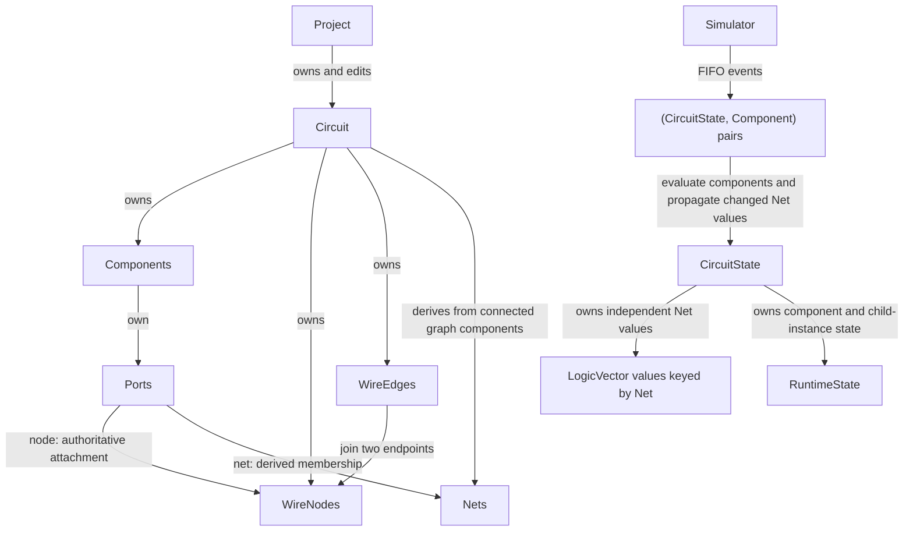
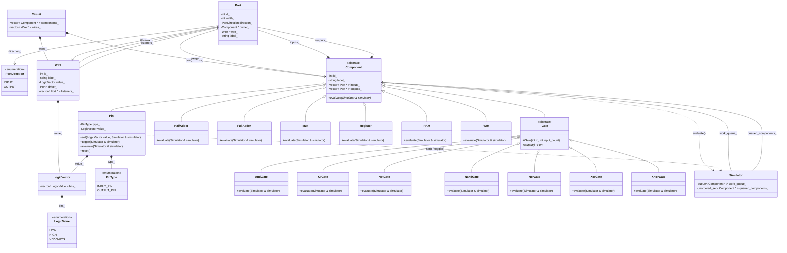

# Simulator design

## Current graph architecture

The maintained implementation uses an undirected graph for electrical
connectivity and derived logical nets for simulation. See the
[current architecture and construction guide](../../docs/index.md) and
[local documentation instructions](../../docs/README.md) for the current API.

`WireNode` and `WireEdge` contain connectivity, not runtime values. `Net`
contains one network's driver, listeners, and compatible width; `CircuitState`
stores each runtime instance's values independently. The simulator schedules
components listening to a changed net; it does not schedule individual edges.
Complete structural edits before creating runtime states. Clear simulator
queues and destroy affected runtime hierarchies before editing again; derived
Net references become invalid after successful connectivity edits.

## Historical design

The original sketch below is preserved verbatim as design history. It predates
both graph-based wiring and the separation of runtime values into
`CircuitState`; its `Wire`, stored pin values, component-only queue, and older
function signatures do not describe the current API. Some sketched components
also remain unimplemented.

The original [SVG export](<LogicVector Input-2026-09-14-145819.svg>) is likewise
an old reference drawing, preserved unchanged rather than published as current
Doxygen architecture documentation.

